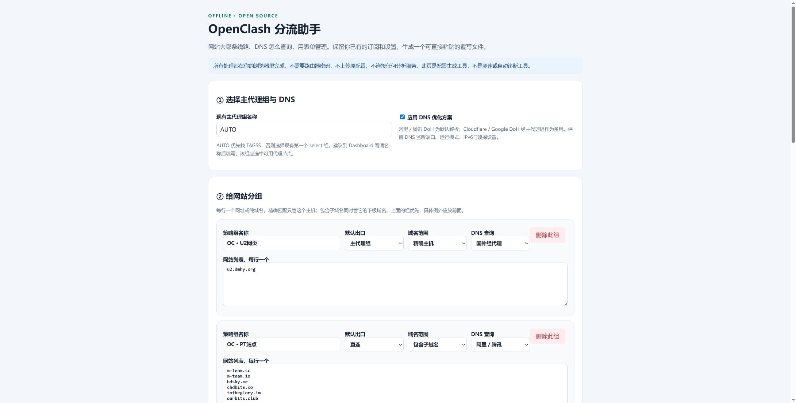

# OpenClash 分流助手

给普通用户使用的离线配置工具。填写策略组名称、批量粘贴网站地址，选择直连或代理、DNS 查询方式，就能生成持久覆写文件。无需编辑开发者选项中的 YAML，也不需要向工具提供路由器密码、订阅链接或节点配置。

**下载整个项目，双击 `index.html` 即可使用。** 所有处理都在浏览器本地完成，无外部脚本、统计服务或网络请求。`index.html` 已打包，不需要安装 Python 或 Ruby 来生成配置。

新手请先看 **[一步一步图文教程](TUTORIAL.md)**，从基础开关、DNS到策略组完整演示。

## 三分钟操作

1. 在自己的 OpenClash「运行状态 → 覆写模块」下载当前 `openclash_custom_overwrite.sh`，保留备份。
2. 打开本项目 `index.html`，填写现有主代理组名称。例如 `节点选择`、`🚀 节点选择` 或 `🙂 TAGSS`，名称必须一致。AUTO 优先寻找 TAGSS，否则取现有第一个 select 组；选择不合适时改为明确名称。
3. 添加策略组。网站列表每行一个网址或域名，如 `https://hdsky.me/`、`m-team.cc`。工具只提取主机，网址的路径、查询参数不会写入配置。不要上传带 Passkey 的 RSS，也无需填写站点账号。
4. 选择默认出口、匹配范围及 DNS。上传步骤1的原覆写文件，点击「生成并检查格式」。下载原文件备份、新文件和 `profile.json`。
5. 回到 OpenClash 覆写模块，全选编辑器内容、粘贴生成文件全文、保存，再重启 OpenClash。
6. 打开 Dashboard，检查新组实际选中的出口；缓存可能保留之前的选择，默认值不是强制重置。测试网页、国内网站与代理网站，确认可用。

更新配置时，重新导入当前覆写文件与保存的 `profile.json`，用表单修改后生成。不要单独在生成代码里改域名。

## 选项怎么理解

| 选项 | 含义 | 举例 |
|---|---|---|
| 默认出口：直连 | 新组首选 DIRECT，Dashboard 可随时切换 | PT站点、哔哩哔哩 |
| 默认出口：主代理组 | 新组首选现有代理组 | U2、HBO |
| 包含子域名 | 匹配域名及所有下级域名 | m-team.cc 覆盖 kp.m-team.cc |
| 精确主机 | 只匹配所填主机 | u2.dmhy.org |
| DNS：沿用默认 | 不为该组添加专用 DNS 策略 | 普通网站 |
| DNS：阿里／腾讯 | 专用加密国内解析 | 普通PT域名 |
| DNS：国外经代理 | 经主代理连接 Google／Cloudflare | U2、存在国内解析异常的域名 |

**DNS 查询出口和网站访问出口相互独立。** 彩虹岛示例使用国外 DNS，但网站属于直连组。默认 DNS 使用阿里／腾讯 DoH；fallback 经代理使用 Google／Cloudflare，不是简单地把国内外所有域名自动二分。已有 nameserver-policy 优先生效；本工具仅覆盖你明确填写的域名。节点引导 DNS 独立使用 223.5.5.5 和 119.29.29.29，避免依赖代理形成循环。

组顺序就是规则优先级。具体例外放在宽泛规则前面，例如先放 `u2.dmhy.org` 精确组，再放其他站点组。精确直连列表优先于新建组，可用于明确的 Tracker 域名；它不代表所有 Tracker 或 BT 对等连接都直连。

## 安装方式与原设置

这个版本是**离线网页工具 + 持久覆写脚本**，不是装进 LuCI 的官方插件。新增代码放在 `BEGIN OPENCLASH OPTIMIZER` 管理段，保留原文件其余内容。重复生成会替换自己的段，而不是叠加多份。重启或更新订阅后会重新执行，修改的是生成的运行配置，不直接改机场订阅源。

保留原规则、节点、订阅、监听端口、TUN、DNS模式、IPv6、域名嗅探及账号。可选开启 DNS 方案；关闭时只添加策略组。普通用户不要因为按钮名字就随意开启全局 respect-rules，本方案直接用 `#代理组` 指定国外 DNS 出口。

生成文件执行时，会先修改配置副本并运行 `/etc/openclash/core/clash_meta -t`；通过后才替换该配置文件。失败会保留诊断文件并退出，不自动尝试其他节点或重启循环。首次操作可能短暂中断代理连接，建议在可以登录本地路由器时进行。

新组与原组同名时拒绝覆盖，默认使用 `OC ·` 前缀。若原来已部署其他脚本管理相同网站，那些脚本仍存在，新规则优先；应先检查已有分组，避免两套工具长期维护同一域名。**本项目没有再次替换作者当前已经正常工作的路由器配置。**

## 恢复

打开同一个覆写编辑器，粘贴安装前下载的 `overwrite-backup.sh` 全文，保存并重启。这会恢复这次修改前的覆写内容。如果以后又增加了其他设置，请先备份当前文件，手动只移除本工具的管理段，避免丢失后续修改。

无法联网时仍可从局域网进入路由器网页。不要删除订阅、恢复整个软路由出厂设置或清空其他应用数据来解决单个 DNS 问题。

## 测试、兼容性与限制

基础方案在 OpenClash 0.47.055、Mihomo alpha-g0d4e57c、Redir-Host/TUN 网络上已有实际验证；通用生成器的逻辑测试与结果记录见 `VALIDATION.md`。不同路由器、OpenClash版本、订阅结构、节点和 DNS 可达性仍需本机检查，不承诺通用测速提升。

运行配置使用 `x-openclash-optimizer` 保存本工具管理的组、规则与 DNS 策略原值，用于重复执行和更新清理；不保存密码或节点。工具保留其他脚本原文，但不会审计你导入的原脚本，也不会运行其中的外来命令。仅导入你自己的可信覆写文件。

域名能解析不代表站点允许访问：403、TLS故障、验证码、登录与账号权限需单独判断。U2 是否走代理依网络实测决定，示例仅反映作者本次需求。站点清单不是站点安全、开放注册或可达性的保证。

## 开发

修改 `ui.template.html` 或 `optimizer.rb` 后运行 `python build.py` 重建 `index.html`。运行 `ruby test_optimizer.rb` 测试生成器；`optimizer.rb` 可在标准 Ruby 或 OpenClash 的 Ruby/YAML 环境执行。离线测试需要 `OCOPT_TEST=1`，生产路由器不要设置该变量。

## 参考与许可

- [Mihomo DNS 官方文档](https://wiki.metacubex.one/config/dns/)
- [Mihomo策略组](https://wiki.metacubex.one/config/proxy-groups/select/)
- [OpenClash官方项目](https://github.com/vernesong/OpenClash)

MIT 开源。公开文件仅包含通用工具和示例域名，不包含作者或朋友的路由器备份、订阅、节点、API 密钥、RSS、Passkey 或站点 Cookie。
