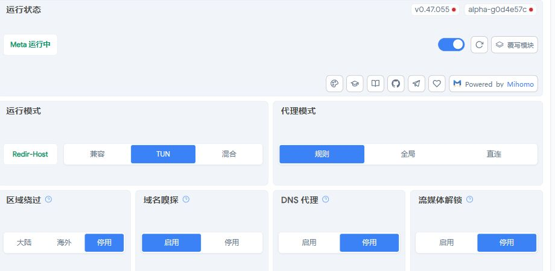
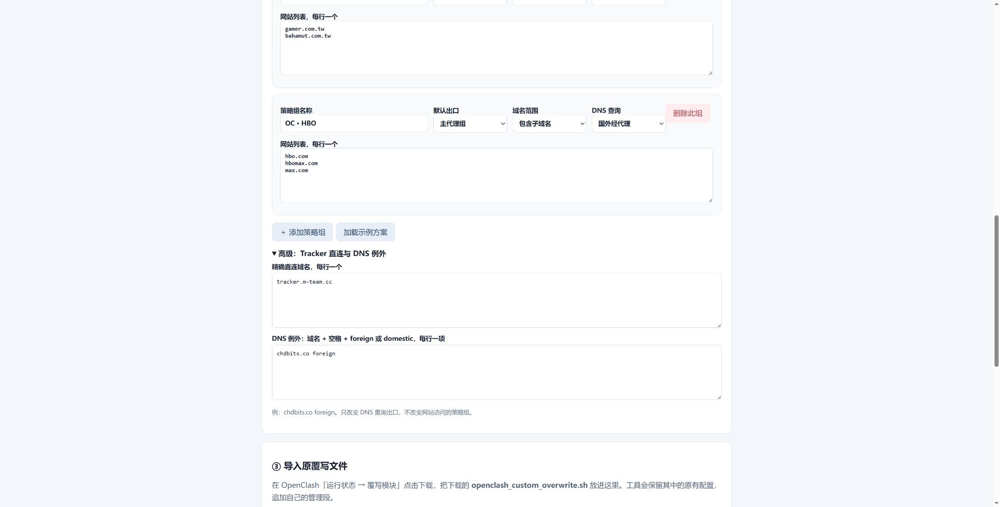
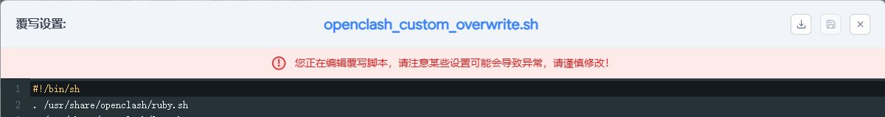
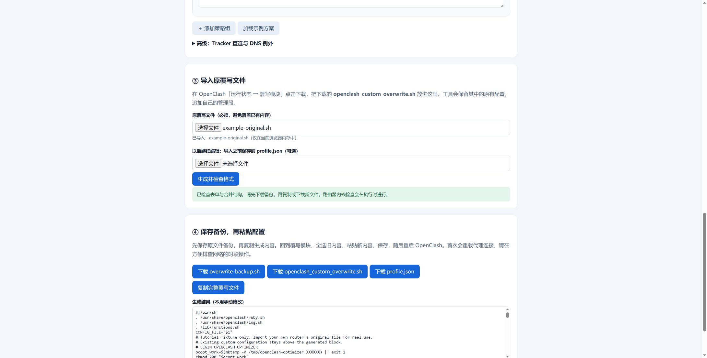

# 从基础开关到自定义分流：一步一步操作

准备：一台已经能正常使用 OpenClash 的路由器、可用订阅、电脑浏览器。本工具用于整理 DNS 与网站策略组，不能替代基础联网、机场账号或节点配置。先连接路由器局域网，能登录管理页面，再开始操作。

## 第1步：确认基础设置

进入「服务 → OpenClash → 运行状态」。下面是本次网络的真实界面截图，已截去私人地址与其他配置区域。



| 界面项 | 本例设置 | 你应该怎么做 |
|---|---|---|
| 代理模式 | 规则 | 要使用策略组分流时选规则；全局或直连会改变整体路由行为 |
| DNS模式 | Redir-Host | 本例使用这个模式；朋友若 Fake-IP 已正常工作，先保留，不要仅为照图改模式 |
| 运行模式 | TUN | 本例是 TUN；先保留设备当前可用模式，旁路由、兼容模式需按拓扑判断 |
| 域名嗅探 | 启用 | 本例保留开启，帮助按域名匹配；这是嗅探流量，不是更换 DNS服务器 |
| DNS代理 | 停用 | 此开关是 respect-rules，表示 DNS连接是否跟随规则，不是关闭整个 DNS；本工具另行指定国外 DNS出口 |
| 区域绕过 | 停用 | 本例让规则统一处理；不要为了速度直接开启绕过而跳过所需策略 |
| 流媒体解锁 | 停用 | 本工具不依赖自动解锁，用策略组选择节点即可 |

若国内网页与代理网页都不通，先检查订阅和节点。不要一口气开关所有选项，否则难以判断原因。本工具不自动修改以上开关。

## 第2步：下载与打开工具

GitHub 项目主页 → 绿色「Code」→「Download ZIP」→ 解压 → 双击 `index.html`。Edge、Chrome 都可以，免安装。也可以仅下载 `index.html`：它是完整离线工具，没有外部依赖。


先在 Dashboard 找到**主代理组的完整名称**，填进工具第①项。例如 `🙂 TAGSS`。别只填它当前选择的某一个节点名称。工具生成的各组会引用这个主组；主组再决定当前节点。

勾选「应用 DNS 优化方案」：默认阿里／腾讯 DoH，国外备用 Google／Cloudflare 经主代理组连接。该方案基于本次实测，不承诺所有地区同样快。若只想添加策略组，取消这个勾选。

## 第3步：批量添加网站

第②项每张卡片就是一个策略组，填名称，选择直连或主代理组，粘贴网站列表，每行一个。

例如 PT卡片：

```text
https://hdsky.me/
https://kp.m-team.cc/
https://chdbits.co/
https://totheglory.im/
```

工具会去掉协议、路径和查询参数，保留域名。注意 `kp.m-team.cc` 与 `m-team.cc` 不同：选择“包含子域名”时，后者会覆盖前者及其他下级域名。填写纯域名可以精确控制范围。

U2 卡片使用 `u2.dmhy.org`、精确主机、主代理组、国外经代理；PT卡片使用直连、包含子域名、阿里／腾讯。这只是本次网络的示例，朋友家是否需要代理要按实际测试决定。

组的顺序决定优先级。宽泛域名不要挡住前面的具体例外。当前版本可以删除后重新添加组来调整顺序，也可以编辑保存的 profile.json 后导入。

## 第4步：设置 DNS 例外

展开「高级：Tracker 直连与 DNS 例外」。



例如彩虹岛网页直连，但国内解析异常，可以填：

```text
chdbits.co foreign
```

这里仅指定“查询 IP 时用哪组 DNS”，不会把网站访问强制改成代理。查询 IP 和连接网站是两件事。不要用固定IP代替域名解析，站点 CDN 地址会变化。

精确直连域名可填已经明确的 Tracker 主机，如 `tracker.m-team.cc`。不要把种子 RSS、Cookie、Passkey 或密码填进任何网站列表。

## 第5步：下载自己的原覆写文件

回路由器「运行状态 → 覆写模块」，出现下图窗口。



窗口右上角依次是**下载、保存、关闭**。先点下载，保存自己的 `openclash_custom_overwrite.sh`。界面版本不同，图标位置可能不同，悬停可查看名称。

把这个文件导入工具第③项。`example-original.sh` 只用于演示，实际使用必须导入自己路由器的原文件。否则可能丢失原来的自定义设置。

## 第6步：生成、备份、粘贴

点击「生成并检查格式」。



成功后下载三份文件：

- `overwrite-backup.sh`：安装前原文件，恢复用，不公开上传。
- `openclash_custom_overwrite.sh`：新完整文件。
- `profile.json`：表单配置，未来导入它继续修改。

点击「复制完整覆写文件」。回路由器覆写编辑器，点击文本区域，**Ctrl+A全选，Ctrl+V粘贴**，点击保存，再关闭窗口并重启 OpenClash。不要把新脚本追加在原文最后；工具已经合并原文。

如果自动复制被浏览器限制，工具会选中输出框内容，按 Ctrl+C；或打开下载的新文件自行全选复制。工具只检查生成结构，路由器执行时还会用内核检查候选配置。报错时看 OpenClash日志，不要重复保存、反复重启。

## 第7步：检查 Dashboard 和网站

进入 Dashboard 的代理/策略组页，找到 `OC ·` 开头的新组。组已出现还不够，确认蓝色选中项正确，尤其是主代理组没有选成 DIRECT 或不可用节点。历史选择缓存可能覆盖首选顺序。

依次测试：一个国内网站、一个普通代理网站、一个直连PT网站、一个专用例外网站。网页慢要区分：DNS慢、连接慢、TLS故障、HTTP403、验证码或站点服务器响应慢。调整 DNS 不会提高运营商带宽或修复站点账号。

更新订阅后再次检查这些组是否存在。覆写会重新追加组和规则，但**换订阅后若主组被改名**，需要在工具里填写新名称并重新生成。本工具不承诺任何订阅结构都无须适配。

## 第8步：后续维护与恢复

增加网站：下载当前覆写文件 → 导入工具 → 导入上次 profile.json → 修改列表 → 重新生成、保存、重启。工具只替换自己的管理段，不叠加多份。

恢复：在同一编辑器把安装前 `overwrite-backup.sh` 的完整内容粘贴回去，保存并重启。若安装后又添加了其他配置，先备份当前文件，只移除 `BEGIN OPENCLASH OPTIMIZER` 到 `END OPENCLASH OPTIMIZER` 的段，避免整份恢复丢失后续改动。

DNS覆写在原“覆写设置 → DNS设置”之后执行。因此 DNS服务器列表可能仍显示原值；最终生效的是管理段生成的运行配置。以后尽量统一用工具维护，不要同时在多个脚本和页面维护同一域名。

本教程使用作者设备基础开关截图与离线工具演示截图，不包含任何路由器密码、订阅节点、API密钥或站点凭据。参考：[Mihomo DNS文档](https://wiki.metacubex.one/config/dns/)、[OpenClash](https://github.com/vernesong/OpenClash)。
